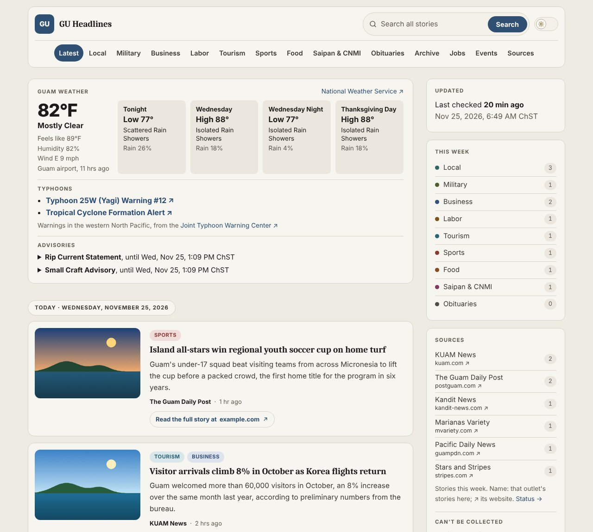

# GU Headlines

Headlines pertaining to the island in one easy source.

GU Headlines is a news website you run yourself. Every hour it visits Guam's
news sites, picks up any **new** stories, and shows them on one page with the
**headline, the story's photo and its first paragraph**. Every story links back
to the news site that published it.

Stories are sorted into topics: **Local, Military, Business, Labor, Tourism,
Sports, Food and Saipan & CNMI**. Everything is kept, so you can search for a
story from last week or from three years ago. Obituaries and death notices
have their own **Obituaries** page, and stay off the front page.



---

## Start here

New to this? Read these guides in order. No programming experience is
needed; you will copy and paste a few commands.

| Guide | What it covers |
|---|---|
| 1. [Getting started](docs/getting-started.md) | Installing it on your computer or server, step by step |
| 2. [Using the website](docs/using-the-website.md) | Topics, search tips, the archive, the Sources page, light and dark mode |
| 3. [Changing settings](docs/settings.md) | Site name, web address and https, how often it checks for news, photos, and every other setting |
| 4. [News sources](docs/news-sources.md) | Adding, pausing, removing and fixing news websites |
| 5. [Topics](docs/topics.md) | How stories are sorted into Local, Military, Business, Labor, Tourism, Sports, Food and Saipan & CNMI (plus Obituaries), and how to change or add topics |
| 6. [Looking after it](docs/maintenance.md) | Backups, updates (also automatic ones), alerts in Discord when something stops working, putting it on the internet with your own domain and https |
| 7. [How it works](docs/how-it-works.md) | Behind the scenes, for the curious and for developers |
| [Jobs](docs/jobs.md) | The Jobs page: which job boards are read, adding a USAJOBS key, and boards that can't be collected |
| [Newsletter feed](docs/newsletter.md) | The feed of top stories for an email newsletter, and connecting SendFox step by step |
| [Events](docs/events.md) | The Events page: which calendars are read, adding a free Google key for the Legislature's calendar, and calendars that can't be collected |

---

## The short version

If you already have [Docker](https://docs.docker.com/get-docker/) installed:

```sh
git clone https://github.com/gottalogin1/GU-headlines.git
cd GU-headlines
cp .env.example .env
nano .env                      # change POSTGRES_PASSWORD, then save
docker compose up -d --build
```

Then open **http://localhost** in your browser. The first stories appear
within a few minutes. The full walkthrough is in
[Getting started](docs/getting-started.md).

## Updating to a new version

New versions are listed on the
[Releases page](https://github.com/gottalogin1/GU-headlines/releases), and
[CHANGELOG.md](CHANGELOG.md) says what changed in each. From inside your
`GU-headlines` folder:

```sh
./scripts/backup.sh            # a backup first, just in case
git pull
docker compose up -d --build
```

Your stories, photos and settings are kept. If `git pull` complains about
your local changes, see [Updating](docs/maintenance.md#updating). A server
that is always on can do this by itself after each change; see
[Automatic updates](docs/maintenance.md#automatic-updates).

---

## What it does

- **Checks every hour** for new stories and downloads only the ones it has
  not seen before. If a site asks it to slow down, it comes back every minute
  until everything is loaded, then returns to hourly.
- **Keeps the photo, headline and first paragraph** of each story. Photos are
  saved on your server, so old stories keep their pictures.
- **Sorts stories into topics** using keyword lists you can edit.
- **Search** finds stories from any date. It understands word endings
  ("workers" finds "worker") and ignores accents ("Hagatna" finds "Hagåtña").
- **Archive** by year, month and day, in Chamorro Standard Time.
- **Weather and typhoon warnings**: a banner on every page while the National
  Weather Service has a watch or a warning for Guam, and a weather box on the
  home page with the airport reading, the forecast, the typhoons in the
  western North Pacific, today's tides and the advisories.
- **Weather page** with the next 24 hours, the week, the surf and the sea,
  sunrise and sunset, and the high and low tides for a day, a week or a
  month, each part linked to its source. Free government data, no key.
  See [Weather](docs/settings.md#weather).
- **Obituaries page** for obituaries, rosaries and funeral notices, kept apart
  from the news. It can show an ad.
- **Light and dark mode**: follows your device's setting, with a switch in the
  top bar. Both modes have a flat, matte look, like a color e-reader screen.
- **Jobs page** lists openings on Guam from eight job boards (GuamJobsOnline,
  GDOE, federal jobs, USAJOBS, UOG, GCC and its partners, GuamTemps), with
  pay, location, open and closing dates, the announcement PDF and when each
  posting was last seen. See [Jobs](docs/jobs.md).
- **Events page** lists what's coming up on Guam over the next 90 days: Guam
  Legislature sessions (with their agendas), hearings and committee
  meetings, GovGuam board and commission meetings, and Guam Community
  College events. See [Events](docs/events.md).
- **Sources page** shows, for each news site, when it was last checked and
  whether anything went wrong, and lists the sites that can't be collected.
- **Private visitor stats** (optional): page views, story clicks, the top
  stories, sources and topics, and the websites readers come from, on a page
  only you can open. Counted on your
  own server, with no cookies, no tracking script and no stored IP
  addresses. See [Visitor stats](docs/settings.md#visitor-stats).
- **Newsletter feed** for an email service such as SendFox: twice a week
  (Tuesday and Friday at 10:00 AM by default), the worker picks the top
  stories since the last time, and the feed keeps them until the next time.
  The site does not link to it. See [Newsletter feed](docs/newsletter.md).
- **Ready for search engines**: every page has its own title and summary,
  a sitemap lists every page worth finding, and links shared on social media
  show a preview card. See [Search engines](docs/maintenance.md#search-engines).
- **Built to last**: a proper database (PostgreSQL), automatic database
  upgrades, a backup script, and settings kept in plain text files.

## The news sites

These are set up out of the box. You can add, pause or remove sites; see
[News sources](docs/news-sources.md).

| News site | Notes |
|---|---|
| The Guam Daily Post | Local news, business, lifestyle and obituaries |
| Pacific Daily News | Local news, sports and lifestyle |
| KUAM News | |
| KANDIT News Group | Opinion pieces and public notices are skipped; its daily list of rosaries and funerals goes to Obituaries |
| Pacific Island Times | Guam and CNMI stories only |
| Marianas Variety | Guam and CNMI stories, including sports and obituaries; loads slowly because the site limits how fast it can be read |
| Stars and Stripes | Guam and CNMI stories only |
| DVIDS (Joint Region Marianas, Naval Base Guam, Camp Blaz) | Military news releases |
| Andersen Air Force Base | The 36th Wing's news releases, read from its DVIDS page because the base's own site turns automated visitors away |
| Guam Department of Labor | Posts rarely |
| Guam Federation of Teachers | The union for GDOE, GMH, UOG, GCC and other public workers; posts rarely |
| Office of the Governor | Press releases |
| Guam Sports Network (GSPN) | Sports |
| Guam Football Association | Soccer: the Matao and local leagues |
| Isla Public Media (KPRG) | The NPR station's own newsroom; Guam and CNMI stories only |
| Guam News Network | Local news, including its National, World and sports stories about Guam; opinion pieces are skipped |

**Listed but not collected.** These sites turn away automated visitors, so
GU Headlines doesn't try to read them. The Sources page and the sidebar list
them separately, with links to visit them directly:
- Marianas Business Journal
- Guam Business Magazine
- Guam Visitors Bureau
- RNZ Pacific (its terms also don't let other websites use its feeds)

To see whether one has started working, and how to switch it back on, see
[News sources](docs/news-sources.md#sites-that-cant-be-collected).

## Folder guide

```
GU-headlines/
├── .env.example        settings template (you copy it to .env)
├── CHANGELOG.md        what changed in each release
├── config/
│   ├── sources.yaml    the list of news sites
│   ├── jobs.yaml       the job boards for the Jobs page
│   ├── events.yaml     the calendars for the Events page
│   └── categories.yaml the topics and their keywords
├── docs/               the guides linked above
├── docker-compose.yml  tells Docker how to run everything
├── scripts/
│   ├── backup.sh       makes a database backup
│   └── auto-update.sh  keeps a server up to date and watched (optional)
└── guheadlines/        the program itself (you don't need to touch this)
```

## A note on content

GU Headlines stores only what a reader sees on a news site's front page: the
headline, a short intro and a photo, and every story links to the original
article. Full articles are not copied. If you make your site public, check the
news sites' terms of use, and give credit (the site already names the source
of every story).
